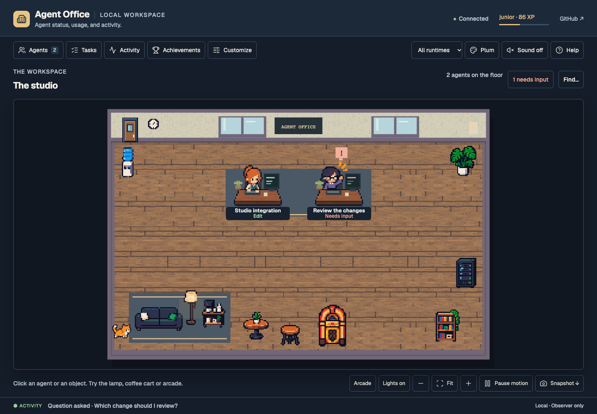

# Agent Office

**A local AI agent dashboard for Hermes, OpenCode, Claude Code, Codex, and Gemini CLI.**

See which coding agents are working, waiting for input, or running subagents in a
pixel-art office. Inspect reported tokens and cost estimates, follow session
activity, and keep your agents' existing tools and permissions.

[**Try the demo**](https://agent-office-preview-seven.vercel.app/) ·
[Quick start](#start-locally) · [Setup guide](docs/setup.md) ·
[Usage and costs](docs/usage.md) · [Documentation](docs/README.md)



**Python 3.10+ · No frontend build required · Local storage · MIT project code**

The hosted demo uses synthetic activity. Your real sessions appear only in your
local office after you connect a runtime. The observer itself needs no account
or API key; any agent CLI you choose to run uses its own account and billing.

## Start locally

Install Git and Python 3.10 or newer, then run:

```sh
git clone https://github.com/NosytLabs/agent-office.git
cd agent-office
python3 run.py
```

Open **[127.0.0.1:8113](http://127.0.0.1:8113)**. Keep that terminal running;
**Ctrl+C** stops the server. An empty room is normal until a connected runtime
reports activity. There is no `npm install`, Docker, or database setup for normal use.

<details>
<summary>Windows (PowerShell)</summary>

```powershell
git clone https://github.com/NosytLabs/agent-office.git
cd agent-office
py -3 run.py
```

Check `py -3 --version` reports Python 3.10+. Use `py -3` in place of `python3`
for the other commands below. Native Windows integrations have not all been
verified; see the [setup guide](docs/setup.md#windows-and-wsl).

</details>

**Just exploring?** Run `python3 demo_feed.py` and open
[127.0.0.1:8114](http://127.0.0.1:8114). This local demo uses temporary data,
separate from your real office, and needs no connected agent.

## Connect an existing runtime

In a second terminal, from the same `agent-office` folder:

```sh
# Preview detected integrations. This does not change configuration.
python3 install.py --dry-run

# Connect only what you use; this example chooses Codex.
python3 install.py --only codex
```

Choices: `hermes`, `opencode`, `claude`, `codex`, `gemini`, `vscode`.
Select several with `--only codex claude`, or omit `--only` to connect all detected
integrations. The installer connects **existing installations**; it does not
install the agent CLIs. Restart the selected runtime, then start a session or run
a tool. Follow any runtime trust prompts in that runtime, not in the office.

**Need help?** The in-app **Connection guide** and
[setup troubleshooting](docs/setup.md#troubleshooting) explain empty rooms,
configuration locations, and runtime-specific steps. Supported events differ by
runtime; see [runtime coverage](docs/runtime-observers.md).

## Activity, usage, and room controls

Find sessions and panels with **Find…** or **Ctrl/⌘ K**. **P / Shift+P** opens the
next/previous session needing input; the browser tab shows a count and clears it
when disconnected. Customize includes section jumps, oak/slate room finishes,
eight companion looks and a searchable gallery with native sprite-strip export.

| What you need | Where to go |
| --- | --- |
| Find work that needs attention | Agents → Needs input, then filter by runtime or search the reported tool/file; a placed attention beacon also opens the next input request |
| Review recent requests and errors | Customize → Activity recap; open Saved activity for retained history |
| Choose which sounds play | Customize → Notification sounds; the main Sound button mutes all kinds |
| Understand tokens and estimated cost | Usage cards and runtime/model breakdowns; [how to read them](docs/usage.md) |
| Prepare or run a new task | Tasks → Draft prompt, [Saved briefs](docs/task-briefs.md) with reviewed JSON import/export, or the opt-in Local runs panel |
| Personalize the office | Customize → Jump to: artwork, layouts, furniture, companions, lighting, and storage |
| Browse or download artwork | Customize → Preview & download sprites: search, category filters, native PNGs, and animation strips |

**A useful daily flow:** open **Agents → Needs input**, select a runtime, and
inspect the session's reported command or question. Respond in the original
agent terminal; the office does not grant approvals. **Active**, **Idle**, and
**Ended** views combine with search, remember your choice locally, and have a
one-click **Clear filters** reset. Usage totals are not narrowed by those filters.

**Inspect before customizing:** session identity, recent activity, and reported
usage come before desk and appearance settings. **Copy summary** copies only the
selected session's timestamped snapshot, with a selectable-text fallback when
clipboard access is unavailable. It never sends a prompt or grants approval;
review paths and command previews before sharing. **Customize agent** jumps to
its preferences without losing your filtered list. Saved activity offers separate
**Export matching** and **Export all saved** downloads beside its filters, so you
choose what to share without scrolling through the results.

Disconnected panels show **last received data**, not a live-status claim, with
**Retry connection** inside the panel. Background tabs refresh less often and
catch up when visible again. [Refresh and filtering behavior](docs/usage.md#find-work-and-understand-freshness).

## Make the room yours

Choose **Room view** below the floor, or press **V**, to expand the office with a
compact HUD. Agents, Tasks, Activity, Customize, runtime filtering and Find stay
available; connection status moves to the footer. **Escape** closes a panel or
finishes furniture editing before exiting Room view. The choice also appears in
**Customize → Layout & atmosphere** and stays in this browser, separately for the
demo and local office. If storage is blocked it works for the current visit and
shows that limitation. Short landscape screens use wider desk rows to keep the
room readable, with navigation and attention controls sharing one row. Rotating
the screen keeps each agent's workstation assignment and focused control.

Click an agent's visible sprite, desk or label to inspect it, including while it
walks into the room. Pointer hints identify the session even when a small floor
cannot show its full label.

Open **Customize** and use **Jump to** to reach a section. **Studio artwork** offers
four-direction character walking, typing/reading/attention animations, companion blink/sleep/happy loops, optional seasonal wall accents,
and a choice of Studio pixel art or Original artwork. The sprite gallery previews
individual sprites and animations, with native PNG and animation-strip
downloads. These artwork choices stay in your browser, separately for the demo and
local office. Missing Studio artwork falls back to the original set;
**Retry artwork** reloads it without discarding unsaved changes.
Use **Clear filters** to restore the complete gallery after a narrow search.
The arcade has a quiet attract loop; a placed printer animates when it opens
latest Activity, also reachable through **Read activity at printer**. These
cosmetic loops stop with Pause or reduced motion and do not report agent work.
[Artwork, gallery, and compatibility details](docs/studio-art.md).

Place up to 24 custom props. Search the furniture catalog by name or prop ID, or
show **Available now** to hide locked rewards. In the room editor, **Props** returns
to the catalog; the **Custom prop** picker selects saved props for moving or removal,
including props that cannot fit on the current floor. Undo and Redo retain up to
20 edits in this session. Select an agent to change its local name, preferred desk,
and appearance. Use **Jump to → History &
storage** to set retention limits.
Motion can be paused, and reduced-motion preferences are respected. Animation
reflects reported activity; it does not prove that an agent completed useful work.

The room also includes a [Duck Hunt, Breakout, and Snake arcade](docs/arcade.md),
[an interactive aquarium](docs/aquarium-assets.md), and a local music jukebox.
These interactions do not send prompts, call models, or award work XP.
Achievements reflect observed activity—not code quality or verified task completion.

## Run a local task

This is optional. To allow **new Codex, Claude Code, or OpenCode tasks** in a chosen project:

```sh
python3 run.py --enable-task-runner --workspace "/absolute/path/to/project"
```

Open **Tasks → Local runs**, select the installed CLI and project, and explicitly
choose **Run task**. This can execute agent work and incur that CLI's usual costs.
The observer never answers permission prompts for existing sessions. With the
runner disabled, use **Draft prompt** to prepare, copy, or export a brief for an
existing runtime. Copying a draft does not dispatch it to OpenCode or another agent.
The hosted demo cannot launch tasks. Read the [runner setup and limits](docs/local-task-runner.md)
before enabling it. Copy and cancellation feedback stays scoped to the selected
run, even when replies arrive late. Idle background run checks use a slower
refresh rate; opening Local runs refreshes immediately.
OpenCode uses a fresh private server (requires 2.0.29+). Refresh CLI discovery
without losing the prompt, search/filter retained runs, and download a selected
run with its prompt and output before restarting the server.

## Usage, privacy, and local data

**Missing usage is “Not reported,” not zero.** Cost is a runtime estimate in USD,
not an invoice or a ChatGPT/GitHub/Vercel plan-usage meter. Partial coverage stays
visible. A cost threshold is an alert, not a spending cap. [Usage guide](docs/usage.md).

Your data stays in `~/.hermes/pixel-office`, or `$HERMES_HOME/pixel-office` when
configured. Event previews can contain commands and file paths; keep the server
on its default loopback address and do not publish your data folder.

Raw event history defaults to **1,000 events / seven days / 5 MiB**. That is not a
whole-directory size limit. Clearing history preserves XP and usage accounting;
resetting progress also clears that ledger. [Retention and safe maintenance](docs/architecture.md).
For terminal diagnostics, browser storage and generated files, see
[logs and cleanup](docs/maintenance.md).

## Update and get help

Stop your local office, then from a clean checkout:

```sh
git pull --ff-only
python3 install.py --only codex
python3 run.py
```

Use the same runtime selection you installed, and restart those runtimes.
Preserve your local edits if Git refuses to pull; do not force-reset the checkout.

[Setup and troubleshooting](docs/setup.md) ·
[Report a bug](https://github.com/NosytLabs/agent-office/issues/new/choose) ·
[Development checks](CONTRIBUTING.md) ·
[Verification limits](docs/audit/README.md)

## Sources and license

Project code is [MIT licensed](LICENSE). Artwork, fonts, runtime marks, and
upstream games retain their [individual notices](web/assets/ATTRIBUTION.md) and
[sprite provenance](web/assets/sprites/ATTRIBUTION.md). Optional licensed Smallburg
art is not distributed here. The dated [7–8 October comparison](docs/reference-review-2026-10-07.md)
and [15 October reference review](docs/reference-review-2026-10-15.md) record source
research and reuse decisions; they are not the current feature backlog.

Agent Office is maintained by **NosytLabs** and is independent of the runtimes
and reference projects it supports.
