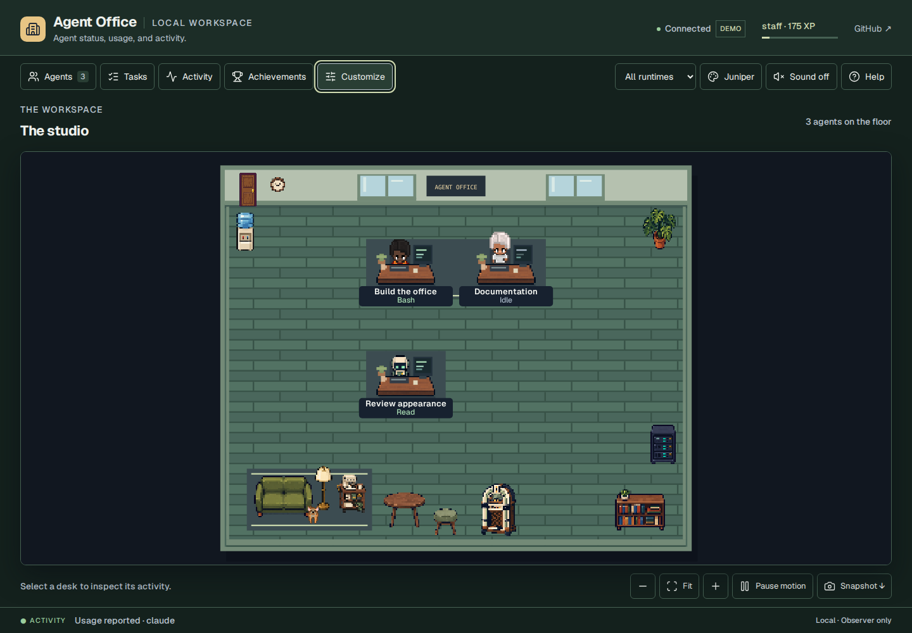

# Agent Office

**A local AI agent dashboard for Hermes, OpenCode, Claude Code, Codex, and Gemini CLI.**

See which coding agents are working, waiting for input, or running subagents in a
pixel-art office. Inspect reported tokens and cost estimates, follow session
activity, and keep your agents' existing tools and permissions.

[**Try the demo**](https://agent-office-preview-seven.vercel.app/) ·
[Quick start](#start-locally) · [Setup guide](docs/setup.md) ·
[Usage and costs](docs/usage.md) · [Documentation](docs/README.md)



**Python 3.10+ · No frontend build required · Local storage · MIT project code**

The hosted demo uses synthetic activity. Your real sessions appear only in your
local office after you connect a runtime. The observer itself needs no account
or API key; any agent CLI you choose to run uses its own account and billing.

## Start locally

Install Git and Python 3.10 or newer, then run:

```sh
git clone https://github.com/NosytLabs/agent-office.git
cd agent-office
python3 run.py
```

Open **[127.0.0.1:8113](http://127.0.0.1:8113)**. Keep that terminal running;
**Ctrl+C** stops the server. An empty room is normal until a connected runtime
reports activity. There is no `npm install`, Docker, or database setup for normal use.

<details>
<summary>Windows (PowerShell)</summary>

```powershell
git clone https://github.com/NosytLabs/agent-office.git
cd agent-office
py -3 run.py
```

Check `py -3 --version` reports Python 3.10+. Use `py -3` in place of `python3`
for the other commands below. Native Windows integrations have not all been
verified; see the [setup guide](docs/setup.md#windows-and-wsl).

</details>

**Just exploring?** Run `python3 demo_feed.py` and open
[127.0.0.1:8114](http://127.0.0.1:8114). This local demo uses temporary data,
separate from your real office, and needs no connected agent.

## Connect an existing runtime

In a second terminal, from the same `agent-office` folder:

```sh
# Preview detected integrations. This does not change configuration.
python3 install.py --dry-run

# Connect only what you use; this example chooses Codex.
python3 install.py --only codex
```

Choices: `hermes`, `opencode`, `claude`, `codex`, `gemini`, `vscode`.
Select several with `--only codex claude`, or omit `--only` to connect all detected
integrations. The installer connects **existing installations**; it does not
install the agent CLIs. Restart the selected runtime, then start a session or run
a tool. Follow any runtime trust prompts in that runtime, not in the office.

**Need help?** The in-app **Connection guide** and
[setup troubleshooting](docs/setup.md#troubleshooting) explain empty rooms,
configuration locations, and runtime-specific steps. Supported events differ by
runtime; see [runtime coverage](docs/runtime-observers.md).

## Activity, usage, and room controls

| What you need | Where to go |
| --- | --- |
| Find work that needs attention | Agents → Needs input, then filter by runtime or search the reported tool/file |
| Understand tokens and estimated cost | Usage cards and runtime/model breakdowns; [how to read them](docs/usage.md) |
| Prepare or run a new task | Tasks → Draft prompt or the opt-in Local runs panel |
| Personalize the office | Customize: themes, desks, characters, furniture, pets, and lighting |

**A useful daily flow:** open **Agents → Needs input**, select a runtime, and
inspect the session's reported command or question. Respond in the original
agent terminal; the office does not grant approvals. **Active**, **Idle**, and
**Ended** views combine with search, remember your choice locally, and have a
one-click **Clear filters** reset. Usage totals are not narrowed by those filters.

Disconnected panels show **last received data**, not a live-status claim, with
**Retry connection** inside the panel. Background tabs refresh less often and
catch up when visible again. [Refresh and filtering behavior](docs/usage.md#find-work-and-understand-freshness).

The room also includes a [Duck Hunt, Breakout, and Snake arcade](docs/arcade.md),
[an interactive aquarium](docs/aquarium-assets.md), and a local music jukebox.
These interactions do not send prompts, call models, or award work XP.
Achievements reflect observed activity—not code quality or verified task completion.

## Run a local task

This is optional. To allow **new Codex or Claude Code tasks** in a chosen project:

```sh
python3 run.py --enable-task-runner --workspace "/absolute/path/to/project"
```

Open **Tasks → Local runs**, select the installed CLI and project, and explicitly
choose **Run task**. This can execute agent work and incur that CLI's usual costs.
The observer never answers permission prompts for existing sessions. The hosted
demo cannot launch tasks. Read the [runner setup and limits](docs/local-task-runner.md)
before enabling it.

## Usage, privacy, and local data

**Missing usage is “Not reported,” not zero.** Cost is a runtime estimate in USD,
not an invoice or a ChatGPT/GitHub/Vercel plan-usage meter. Partial coverage stays
visible. A cost threshold is an alert, not a spending cap. [Usage guide](docs/usage.md).

Your data stays in `~/.hermes/pixel-office`, or `$HERMES_HOME/pixel-office` when
configured. Event previews can contain commands and file paths; keep the server
on its default loopback address and do not publish your data folder.

Raw event history defaults to **1,000 events / seven days / 5 MiB**. That is not a
whole-directory size limit. Clearing history preserves XP and usage accounting;
resetting progress also clears that ledger. [Retention and safe maintenance](docs/architecture.md).

## Update and get help

Stop your local office, then from a clean checkout:

```sh
git pull --ff-only
python3 install.py --only codex
python3 run.py
```

Use the same runtime selection you installed, and restart those runtimes.
Preserve your local edits if Git refuses to pull; do not force-reset the checkout.

[Setup and troubleshooting](docs/setup.md) ·
[Report a bug](https://github.com/NosytLabs/agent-office/issues/new/choose) ·
[Development checks](CONTRIBUTING.md) ·
[Verification limits](docs/audit/README.md)

## Sources and license

Project code is [MIT licensed](LICENSE). Artwork, fonts, runtime marks, and
upstream games retain their [individual notices](web/assets/ATTRIBUTION.md) and
[sprite provenance](web/assets/sprites/ATTRIBUTION.md). Optional licensed Smallburg
art is not distributed here. [Source references and reuse decisions](docs/reference-review-2026-10-07.md).

Agent Office is maintained by **NosytLabs** and is independent of the runtimes
and reference projects it supports.
