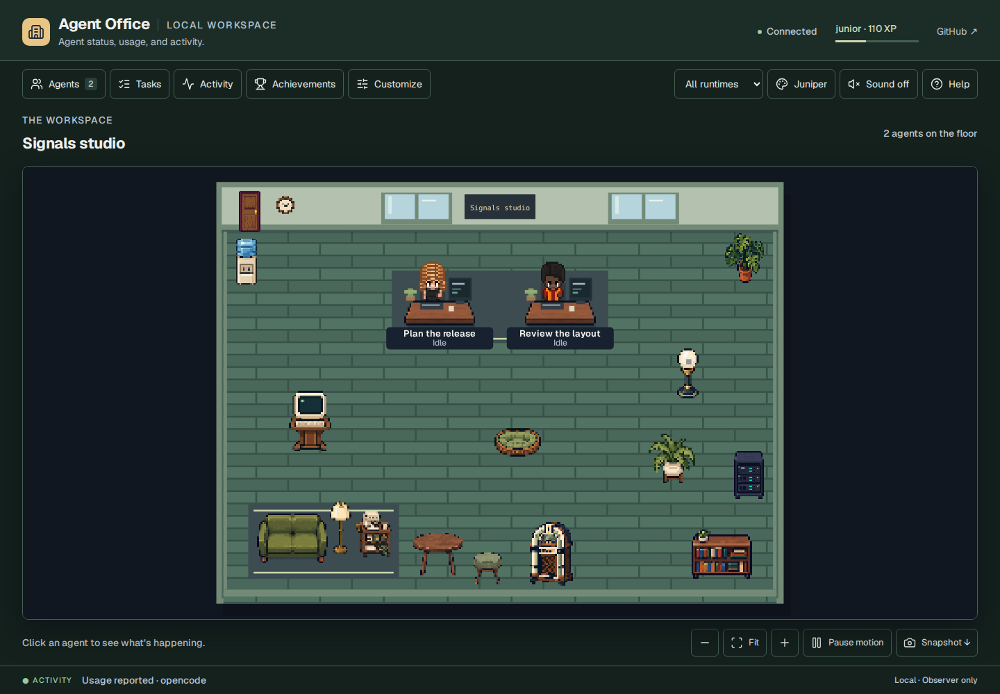

# Validation and integration limits

This is a verification snapshot, not a promise that every runtime or device has
been tested. Browser fixtures use synthetic activity and isolated data folders;
they do not represent paid-provider work or the owner's live sessions.

## Current local validation

The 12 October 2026 session-triage, connection, and polling improvements were checked
against baseline [`0fa417f`](https://github.com/NosytLabs/agent-office/commit/0fa417f946f642e88eb0c234faf46d83471952c3)
using Python 3.14.4, Node 22.23.2, and Playwright 1.63.0 Chromium on Linux.

| Check | Recorded result |
| --- | --- |
| Python suite, including repository and diagnostic regressions | **622 passed**, **2 native Gemini fixture skips** |
| Node models, controllers, and bridges | **127 passed** |
| Browser flows | **243 passed**, **1 optional private-art skip** |
| Compiled sprites | **47 sprites** match **23 original sheets** |
| Syntax, formatting, local documentation links, and tracked-artifact checks | Passed |
| Public builds | **106 demo files** and **20 product-site files** |

The native Gemini tests require an explicit installed CLI path. The private-art
case requires the owner's licensed Smallburg pack; public art and synthetic
fallback tests run without it. A successful Vercel deployment is not a test-suite
result. Consult the actual commit's checks for hosted status. Earlier results
and source-review context remain in [history](history.md).

Eleven new browser cases cover selected-runtime setup commands, combined status/
runtime/search filtering, view persistence, retained-data notices, explicit retry,
single-flight requests, hidden-tab cadence, failure backoff, visible-tab refresh,
useful tool details, cached portraits, and refresh without AbortSignal.any.
The new layout was exercised at 1280, 390, and 320 pixels with no horizontal page
overflow, 44-pixel status controls, and contained keyboard navigation. Screenshots
were captured; the narrow Agents panel was visually reviewed. These are Chromium
checks, not a claim of authenticated provider sessions or physical mobile coverage.

An existing paused-aquarium test now waits for the actual enabled control within
a bounded timeout instead of relying on a particular observer-poll phase. Feeding
behavior, cooldown, artwork, and accounting were not changed by that test repair.

## Reproduce the checks

Use the [development setup](../../CONTRIBUTING.md#development-setup), then run:

```sh
python3 tools/check_repository.py
python -m pytest -q
npm test
npm run check
npm run format:check
npm run check:sprites
npm run test:browser
npm run build:preview
```

`check_repository.py` inspects the Git index and tracked working files only.
Tracked symlinks to untracked or local-only files are rejected before content is
read. Rejected local data is never parsed as documentation. It
checks local Markdown paths/anchors, tracked logs/caches/local data, and conflict
markers without making network requests or deleting files. It is not a complete
Markdown parser or a secret-content scanner. Stage intended new source files
before running it; untracked local files cannot satisfy a committed docs link.

The small [repository-hygiene workflow](../../.github/workflows/hygiene.yml)
also checks documentation-only changes without installing npm packages or
running browsers. The separate [CI workflow](../../.github/workflows/ci.yml)
continues to run application checks for code changes and retains browser
artifacts for three days.

## Automated coverage

| Area | Main tests and contract |
| --- | --- |
| Publication, transactions, reset, and replay | `test_event_inbox.py`, `test_event_store.py`, `test_reset_protocol.py` |
| Retention, measurements, and explicit compaction | `test_storage_health.py`, `test_storage_maintenance.py`, `test_event_cache.py` |
| Settings and preferences | `test_settings_concurrency.py`, `test_personalization.py`, and corresponding browser flows |
| Lifecycle, usage, and reported tasks | `test_state_model.py`, `test_agent_lifecycle.py`, `test_usage.py`, `test_tasks*.py` |
| Runtime hooks and local task processes | `test_runtime_adapters.py`, runtime-specific hook tests, `test_task_runner*.py` |
| Office, rooms, assets, arcade, and mobile controls | Node models and browser files listed by `package.json`; `test_assets.py`; `native-sprites.test.cjs` |
| Log failure handling | `test_observer_logging.py`: concurrent failures, bounded warnings, redaction, continued publication, broken log handlers |
| Repository hygiene | `test_repository_hygiene.py`: real temporary Git indexes, generated artifacts, local links, anchors, and code examples |

The [tests directory](../../tests) is the source of truth for individual cases.
Do not copy changing test totals into feature descriptions or treat synthetic
fixtures as installed-runtime proof.

## Interface evidence



| View | Screenshot |
| --- | --- |
| Aquarium | [Fish selection and feeding](../screenshots/aquarium.png) |
| Usage | [Reported counters and coverage](../screenshots/usage.png) |
| Settings | [Desk, pet, and saved-choice controls](../screenshots/settings.png) |
| Personalization | [Individual desk and character preferences](../screenshots/personalization.png) |
| Appearance | [Juniper, walnut desks, and a delegated robot](../screenshots/appearance.png) |
| Product website | [Responsive product introduction](../screenshots/product-site.png) |
| New interactive props | [Desktop](../screenshots/signals.png) and [320-pixel mobile reflow](../screenshots/signals-mobile.png) |
| Pet bed | [Cat resting at the placed bed](../screenshots/pet-bed.png) |
| Gemini lifecycle | [Mobile inspector with a synthetic hook fixture and unreported usage](../screenshots/gemini-mobile.png) |
| Narrow office heading | [A 48-character name at 320 pixels](../screenshots/long-office-name-mobile.png) |
| Keyboard settings | [Visible focused control below the sticky header](../screenshots/keyboard-settings.png) |
| Arcade | [Duck Hunt with a scored hit](../screenshots/arcade-duck-hunt.png) and [Breakout in play](../screenshots/arcade-breakout.png) |
| Snake | [Desktop play](../screenshots/arcade-snake-desktop.png) and [mobile controls](../screenshots/arcade-snake-mobile.png) |
| Room toys and characters | [Moss engineer and Orbit courier in the office](../screenshots/office-toys.png) and [saved room lighting](../screenshots/room-lights.png) |
| Aquarium interactions | [Public fish, tank lighting, and visible artwork source](../screenshots/aquarium-interactions.png) |
| Local task runs | [Desktop form](../screenshots/local-runs-desktop.png), [completed fixture output](../screenshots/local-runs-output.png), and [320-pixel mobile output](../screenshots/local-runs-mobile.png) |
| Task console | [Original generated console in the assembled office](../screenshots/task-console-running.png) |

See [the preview guide](../preview.md) for the demonstration and [CONTRIBUTING.md](../../CONTRIBUTING.md) to reproduce local browser checks.

## Integration limits

**Runtime coverage is version-specific.** The earlier Gemini CLI 0.63.0 review
exercised real hooks against a synthetic loopback provider, not a paid account.
That opt-in check was not repeated in this cleanup. Hermes, Claude Code, Codex,
and OpenCode adapters are fixture-tested here; authenticated installed sessions
remain unverified. See [runtime contracts](../runtime-observers.md).

**Local runs start fresh processes.** Tests use temporary Codex/Claude-shaped
executables. They do not prove authentication, model access, provider completion,
or compatibility with every CLI version. POSIX process-group cleanup is covered;
native Windows cleanup is still unverified/best-effort. Existing-session OpenCode
handoff and durable delivery receipts remain open in
[issue #18](https://github.com/NosytLabs/agent-office/issues/18).
See the [runner contract](../local-task-runner.md).

**VS Code packaging is not extension-host verification.** Earlier VSIX packaging
and simulated-API/real-HTTP tests passed. Actual installation, activation, remote
forwarding, and authentication still need a working VS Code host. Physical
mobile devices and Safari/iOS were not independently exercised in this cleanup.

**Usage and task data remain observations.** Missing counters stay unknown;
runtime costs are estimates, not invoices. A completed session does not complete
its task list. Recent capture replays have bounded memory; a previously unseen
capture without a source clock follows receipt order. See
[usage and task contracts](../runtime-observers.md).

**Retention is not a whole-directory quota.** Raw history uses the configured
count/age/byte limits. Compact accounting and unresolved prompts survive pruning;
usage identities can grow, pending offline inbox files remain, and legacy JSONL
files are read-only. Invalid/unavailable retention settings suspend pruning.
Settings locks protect cooperating local servers, not arbitrary external editors,
network filesystems, or power-loss durability. See
[storage and maintenance](../architecture.md#storage-and-retention).

**Diagnostics are separate from event history.** Repeated hook-publish failures
emit at most one warning per minute per process, with a suppressed-count summary
on the next warning. Raw exception messages and event bodies are not included in
that warning. All event attempts still occur, and logging failures cannot escape
into the agent loop. This is not a global quota on external service logs; see
[diagnostics and safe cleanup](../architecture.md#diagnostic-logs-and-safe-cleanup).

## Source and asset review

The dated [reference review](../reference-review-2026-10-07.md) preserves inspected
sources and reuse decisions. It is background, not the current feature backlog.
Automatic orchestration, agent hiring, and answering permission prompts are not
implemented by copying a product description.

Original artwork and licenses are preserved. The public aquarium uses original
fish; the owner's optional commercial Smallburg pack is installed outside Git.
Duck Hunt package metadata is not a separate license for its artwork/audio.
Consult [arcade provenance](../arcade.md), [sprite provenance](../../web/assets/sprites/ATTRIBUTION.md),
[font/icon/runtime marks](../../web/assets/ATTRIBUTION.md), and
[optional aquarium artwork](../aquarium-assets.md).
