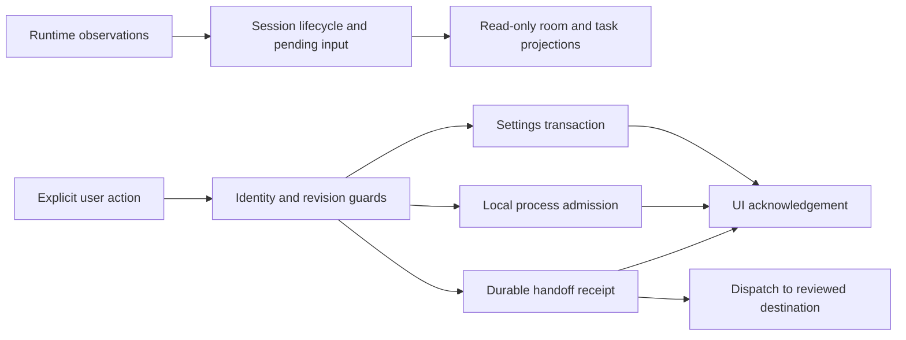

# State machines and transition contracts

This is the source map for Agent Office's lifecycles, including the implicit
machines encoded by flags, pending promises, collection membership, revisions,
timers and resource handles. Use it alongside [architecture](architecture.md)
when changing a user flow or giving an implementation task to a coding agent.
It describes source behavior, not a proof that every possible interleaving or
installed runtime has been tested.

## Decision: separate owners, explicit transition boundaries

Keep the existing domain owners and dependency-free frontend. A single global
state enum would conflate independent facts: a connected observer can have
unavailable settings; a hidden panel can have a running process; a submitted
prompt can have uncertain delivery; an idle avatar can still represent an
unanswered request. An artwork or animation state is never evidence of work.

Make the boundary explicit where a transition has consequences: identify the
event, check its guard, commit its durable effects, then acknowledge it. Derive
labels and enabled controls from the same owner. Do not add another writable
`phase` merely to mirror existing authoritative fields. Introduce a reducer or
transition table within one domain only when it removes competing writers and
has behavior-preserving tests; no framework migration is needed for this audit.

| Experience | Contract |
| --- | --- |
| UX | Preserve drafts, selection and reading position. Distinguish loading, failure, stale observations and uncertain delivery. Show the next valid recovery action. |
| DX | One owner per fact, named guards, bounded effects, and regressions that control event order rather than sleep until a race happens. |
| AX | Stable session/request/call identities; inspectable receipts; truthful outcomes; explicit destinations. Reading, copying, animation, and polling never execute work. |

Three identities must not be substituted for one another:

- **View generation** decides whether an asynchronous result still belongs to
  the current selection, panel visit or draft.
- **Write precondition** is the settings revision or the exact reviewed
  destination snapshot. A late read cannot acquire the revision of a newer save.
- **Operation identity** deduplicates a request whose delivery is uncertain.
  A timeout, reload or new view does not authorize a second dispatch.

## Browser shell, preferences and saved briefs

These are implicit unless an explicit mode is called out. Each row is a
separately owned lifecycle or orthogonal region, not a proposed new class.

| Machine / owner | States and events | Guard and observable effects |
| --- | --- | --- |
| Observer polling — [office.js](../web/js/office.js), `poll` | Initial → in-flight → connected or disconnected/backoff → retry; page exit stops; cached-page restore resumes | One poll promise; abort deadline; preserve last data as stale on failure; settings revision captured before request. |
| Settings readiness — [office.js](../web/js/office.js), `confirmSettings`, `blockSettings` | Loading → readable/revisioned or unavailable → repaired | Editing requires a valid revision. Unreadable settings remain unavailable instead of becoming writable defaults. |
| Settings write queue — [office.js](../web/js/office.js), `saveSettings` | Optimistic patch → queued → writing → acknowledged, rejected or conflict | Serialize writes; send confirmed ETag; conflict invalidates older queued generations; rollback uses confirmed values plus newer valid patches. |
| Form drafts — [office.js](../web/js/office.js), `settingsDrafts` | Clean → edited → submitted → clean only if submitted value still current | Polling and delayed acknowledgement cannot clear newer typing. Per-field draft versions guard dependent feedback. |
| Agent preference mutation — [office.js](../web/js/office.js), `saveAgentPreferences` | Editable → pending → confirmed or rolled back; inactive-preference cleanup has its own pending guard | Canonical session identity, current roster and available desk determine validity; writes use the shared settings queue. |
| Panel navigation — [office.js](../web/js/office.js), `openSheet`, `backSheet`, `closeSheets` | Closed ↔ selected panel; bounded back stack; panel visit generations | Lock background and restore focus/scroll; task controllers close on departure; returning to a panel does not revive an old clipboard operation. |
| History loading — [office.js](../web/js/office.js), `loadHistory` | Unloaded → loading → loaded or error; loaded → refreshing → refreshed or stale data with error | Request identity invalidates results after clear/reset; one in-flight read; failed refresh retains readable history. |
| History scroll restoration — [office.js](../web/js/office.js), `restoreHistoryScroll` | Pending saved offset → rows/fonts ready → restored or cancelled by user navigation | Panel, request generation and user interaction must still match before moving scroll. |
| History clear / progress reset — [office.js](../web/js/office.js) | Explicit confirmation → request → cache invalidation on acknowledgement or error | Separate destructive actions with different data scopes; reset does not imply settings, handoff or process cancellation. |
| Clipboard feedback — [office.js](../web/js/office.js), inspector/setup copy | Requested → pending permission → copied, manual fallback or obsolete | Visit, selected identity, copy generation and visibility guard completion; fallback selects text only when the action still owns focus. |
| Attention / reward notices — [office.js](../web/js/office.js), [attention.js](../web/js/attention.js) | Previously seen → new observation → announced → dismissed/resolved/expired | First snapshot seeds seen identities without replaying alerts; waiting navigation requires connected state, no editor and no conflicting panel. |
| Toast lifetime — [office.js](../web/js/office.js), `toast` | Visible → timer/dismissal/eviction → removed | Bounded visible messages; duplicate-message timer renewal and focus recovery do not alter work state. |
| Recap review marker — [office.js](../web/js/office.js), `loadRecapChoices`, `saveRecapChoices` | Today / since-review; explicit mark reviewed → persisted or failed | Local viewing marker only; retained history bounds what can be summarized; unknown/corrupt storage does not erase source events. |
| Room/view restoration — [office.js](../web/js/office.js), [view-state.js](../web/js/view-state.js) | Unrestored → validated view restored once; edits → saved or visit-only | Namespaced browser preferences restore reading views; never restore playback, editing, pan, follow or execution. Reduced motion overrides saved animation. |
| Quick navigation — [quick-nav.js](../web/js/quick-nav.js) | Closed ↔ open/searching/selected; composing; destroyed | Preserve selected result identity on refresh; recheck session presence on pick; shortcuts respect editing and IME; actions open views only. |
| Demo storage — [preview.js](../web/js/preview.js), `database`, `accessSaved` | Opening → transactional persistence; blocked/failed → explicit visit-only memory; corrupt data → unavailable | Revision compare and replacement share one transaction. Queued reads cannot undo edits after persistent storage fails. |
| Demo migration — [preview.js](../web/js/preview.js), `readStored` | Legacy record → validated snapshot → IndexedDB commit → old key removal | Original bytes remain until successful migration; unreadable input is not overwritten; legacy identity detects stale full-map saves. |
| Demo notifications — [preview.js](../web/js/preview.js), `refreshOtherView` | Storage/broadcast notice → authoritative read → reconcile | Capture the local settings revision before awaiting; late notifications cannot roll back a newer acknowledged edit or its ETag. Notification itself is not a commit. |
| Demo sample lifecycle — [preview.js](../web/js/preview.js) | Sample / history-cleared / reset → explicit restore | Serialized saved flags, synthetic-only renderer, and invalidated history requests; no calls to real runtimes. |
| Brief library storage — [prompt-library.js](../web/js/prompt-library.js), `createStore` | Readable → compared/written → new revision; unreadable → unavailable → retry | Exact stored bytes and schema validated; bounded collection; conflicts preserve both stored data and open draft. |
| Brief mutation — [prompt-library.js](../web/js/prompt-library.js), `mutate` | Idle → waiting for lock → saving → result → idle; destroyed invalidates work | Web Lock plus fresh revision check; storage generation rejects obsolete work; focus recovery only for the operation's lost control. |
| Brief review/import — [prompt-library.js](../web/js/prompt-library.js) | No review → reading or load/rename/delete/import review → explicit apply or cancel | File, review, storage and draft generations guard delayed results. Append/replace/merge limits checked before mutation; loading a brief never submits it. |
| VS Code panel — [extension.js](../vscode/extension.js), [panel.js](../vscode/panel.js) | Absent → forwarding/connecting → connected, offline or error; reload supersedes; disposal cancels | Panel identity/token and abort controller gate late forwarding/probe results. Fixed commands only; iframe owns ongoing polling. |
| Product-site tabs/fragments — [site.js](../site/site.js) | Selected tab plus independent focused tab; fragment change reveals target | Manual keyboard activation; fragment cancels earlier scroll task; copy feedback invalidates when content changes. |
| Product-site menu — [site.js](../site/site.js) | Closed ↔ open; desktop/mobile breakpoint changes | Escape/outside focus/link activation closes; move focus to a visible counterpart when responsive layout hides its owner. |
| Product-site clipboard — [site.js](../site/site.js) | Idle → pending → copied/fallback/obsolete | Per-button pending set, generation, exact text and visibility guards; never a shell execution action. |

## Process execution, delivery and task views

Owners: [task_runner.py](../task_runner.py),
[opencode_handoff.py](../opencode_handoff.py),
[task-runner.js](../web/js/task-runner.js),
[handoff.js](../web/js/handoff.js), [task-desk.js](../web/js/task-desk.js),
[tasks-view.js](../web/js/tasks-view.js).
Process and receipt states are named; their admission, I/O, draft and request
coordination lifecycles are mostly implicit.

<!-- Domain inventories follow; maintain these with their owners. -->
| Machine / owner | States and events | Guards and effects |
| --- | --- | --- |
| Runner capability / `TaskRunner` | serving → closing on shutdown; executable discovery can refresh while serving | New admissions reject closing, unavailable CLI, changed project path, full global slots, or occupied workspace. Already admitted workers retain executable paths. |
| Runner admission / `create`, `_release_slot` | absent → reserved (`running`, `holds_slot`, no process) → executing → terminal; reservation failure → failed | One RLock serializes request-ID deduplication, slot reservation, and per-workspace ownership. Release occurs only after worker launch failure or process cleanup. |
| Run execution / `_execute` | running → succeeded / failed / cancelled / interrupted | `cancel_requested` and `interrupt_requested` are intent flags, not terminal outcomes. Shutdown interruption takes precedence. Terminal publication follows reaping/closing; zero exit means process finished, not reviewed work. |
| Worker I/O / `_execute` | stdin not started → feeding → closed; output accumulating → capped while still draining → EOF | A separate stdin worker prevents pipe deadlocks. Output truncation does not stop draining. Failed worker allocation triggers process cleanup before releasing admission. |
| Local-run idempotency / `_request_ids` | absent → admitted identity → retained terminal identity → pruned | An unchanged request returns the same run; different fingerprint conflicts. IDs expire when bounded terminal history is pruned. Restart changes instance identity. |
| Handoff pairing / `pair`, `unpair` | unpaired ↔ paired, with validating/persisting transition | Review requires loopback origin, session/project identity, and supported health contract. Pairing is global to the adapter. Save failure must preserve previous visible pairing. |
| Receipt ledger / `ReceiptLedger` | persisted snapshot → tentative update/prune → committed snapshot; failure → previous snapshot | Atomic replacement precedes observable success. A first receipt must exist durably before dispatch. Failed update rolls back memory including pruning. |
| Handoff operation / `submit`, `_dispatch` | submitted → accepted / unknown / rejected / failed | Durable identity before POST; repeated request ID returns its retained receipt before destination comparison. Browser sends `expected_pairing`, checked under the adapter lock before new dispatch; omitted field retains legacy API behavior. A response timeout is unknown when dispatch may have occurred, not permission to resend. |
| Handoff reconciliation / `_reconcile` | Nonterminal → executing / awaiting_input or terminal; confirmed unknown → accepted when idle; otherwise preserve latest evidence | Runtime history establishes delivery; missing history does not prove non-delivery. Terminal receipts are absorbing. Unavailable runtime preserves prior evidence. A completed assistant response or abort error determines completion/cancellation. |
| Handoff cancellation / `cancel` | active + no request → active + cancel requested → runtime-confirmed terminal | An acknowledged session abort sets intent but cannot itself claim cancellation. The same server and session must remain paired. |
| Handoff receipt retention | active and terminal history → terminal pruning | Only terminal receipts may be pruned; uncertain operations retain identity. Ledger corruption is not silently reset. |
| Runner browser connection/polling | preview / disconnected / disabled / enabled; poll idle ↔ in-flight; discovery idle ↔ in-flight | Same-origin request and token; poll sequence ignores superseded reads. Hidden tab pauses polling. Running work or open panel increases poll frequency. Discovery blocks submission. |
| Runner browser submission | draft → submitting → acknowledged receipt or uncertain retry; server change → review required | Explicit Run only. Pending UUID binds payload and server instance; unchanged uncertain retry reuses it. Form edits/new draft reset identity. Browser feedback does not award XP or mutate observer state. |
| Runner selection/output | unselected → selected summary → loading → output ready / error; old selection → invalidated | Selection, detail, and copy generations prevent late responses and clipboard fallbacks hijacking a new panel. Cancellation invalidates stale reads before and after response. |
| Runner output reading | following newest output ↔ reading earlier output; resume → follow | Scroll anchoring and selection preservation avoid polling moving the user's reading location. Output copy/export is separate from process execution. |
| Runner draft retention | off / deferred until capability / saved / unsaved storage failure / restored / review required | Session storage is opt-in, bounded, origin-local. Restore cannot overwrite edits made before capability arrives. Unknown instance/pending ID requires explicit review. |
| Handoff browser connection/polling | preview / disconnected / disabled / enabled; inactive/active; poll idle/in-flight | Response generations suppress stale reads. Hidden tabs pause polls. Pair/send/unpair form an exclusive destination transition, and polling cannot supersede its acknowledgement. |
| Handoff destination controls | idle → pairing / sending / unpairing → idle with confirmed result or error | Destination changes cannot overlap Send. Successful null pairing immediately clears paired UI and disables Send. Draft survives unpairing. |
| Handoff selected receipt/actions | unselected → selected summary → detailed; refresh/cancel requests with detail generation | Selection and response IDs constrain which receipt is updated. Cancel request and actual terminal operation remain distinct. |
| Handoff draft retention/idempotency | off / saved / deferred / restored; pending send → acknowledged or uncertain; mismatch → review required | Remembered payload stores destination snapshot and instance identity. Lost acknowledgement retains request ID over reload. Legacy uncertain drafts lacking a snapshot require review; acknowledged explicit pairing preserves text and clears the review gate before a separate new Send. An acknowledged re-send is a new intentional dispatch. |
| Task desk retention / `task-desk.js` | ephemeral ↔ retention requested ↔ retained; write failure → previous retained state; failed opt-out remains pending | `retained` and `wantsRetention` intentionally differ on storage failure. Editing after failed opt-out must not save fresh text. Character limits count code points. |
| Task desk clipboard/export | valid/invalid draft; copy pending → copied/fallback/obsolete | `copyVersion` and panel interaction invalidate old clipboard completion. Copy/export never dispatch a prompt. Export revokes its temporary URL. |
| Reported task projection / `tasks-view.js` | unavailable / valid empty / valid populated; rows pending / in_progress / completed / cancelled; board live/historical | Task states come from the runtime, not UI actions. Duplicate session IDs disable ambiguous navigation. Identical projection signatures preserve DOM/focus; changes restore focused board identity. |

## Observer, persistence and adapters

The durable transaction and publication protocols are state machines even when
no `state` enum is stored. Do not replace their atomic boundaries with a
browser lifecycle abstraction.

| Machine / owner | Representation | States and transition triggers | Required invariant / recommended decision |
| --- | --- | --- | --- |
| Observer listener ownership — [__init__.py](../__init__.py), `_serve` | Implicit thread handle, liveness, bind/probe results | Absent → starting → serving; bind conflict → feed-only; exited + no listener → eligible for next publication retry; fork resets ownership | Keep startup separate from ingestion locks, at most one local pending worker. Never turn hook publication into runtime control. Existing ownership guards should stay. |
| Background ingestion worker — [__init__.py](../__init__.py) | Implicit worker + stop event | Not started → pass → one-second wait → next pass; failure → bounded diagnostic → retry; shutdown → stop after current pass | No overlapping maintenance passes; HTTP assets remain independently serviceable; bounded shutdown does not pretend to cancel blocked filesystem IO. |
| Hook diagnostic throttling — [__init__.py](../__init__.py), server warning helper | Implicit monotonic timestamp and suppressed count | First failure logs; failures inside 60s suppress logs; cooldown permits a summarized diagnostic; broken logger remains fail-open | Suppression applies only to diagnostics, never event publication attempts. No event bodies in diagnostics. |
| Python inbox publisher — [event_inbox.py](../event_inbox.py) | Implicit temporary/ready file, writer UUID/sequence, epoch | Read epoch → allocate ordered identity → write/flush/fsync temp → atomic rename ready; failure → temp cleanup; fork → new writer/lock | Ready filename never reused; no partially written ready envelope; intentional equal payloads are independent publications. |
| OpenCode inbox publisher — [opencode/index.js](../opencode/index.js) | Same protocol encoded in JS control flow | Epoch read → writer/sequence → temporary write → ready rename; failure stays local to observer | Preserve protocol parity and fail-open runtime hooks. |
| Consumer transaction and receipt ownership — [event_store.py](../event_store.py) | Implicit SQL transaction, receipt rows, source files | Ready → validated/applied or invalid/old-epoch counted/skipped → effects+receipt commit → source deletion → receipt retirement; precommit failure rolls back; postcommit failure retries cleanup | Live state, tasks, XP, usage, history and receipt commit together. Cleanup must stay after commit. Do not replace this with an in-memory FSM. |
| Read retry and publisher barrier — [event_store.py](../event_store.py) | Durable `inbox_retries` rows + inferred writer identity | Read failure → deferred; deadline/corrected backward clock → eligible; absent/readable → barrier cleared; later same-writer records blocked; other writers continue | Preserve per-writer correction order and fairness. Unknown publisher filenames must not gain invented ordering relationships. |
| Legacy import/rewrite cursor — [event_store.py](../event_store.py) | Implicit signature, count, digest, fingerprint occurrence counts, `legacy_started`, `inbox_received`, reset guard | First migration → timestamp-compatible initial fold; stable append → unseen suffix; rewrite → occurrence conservation; changed during read → retry; unreadable → preserve cursor | Once immutable inbox received, legacy replacement cannot erase current live state. No JSONL truncation. |
| Reset publication epoch — [event_store.py](../event_store.py) | Mixed durable intent with version/epoch/reset plus database epoch | Stable legacy boundary → durable reset fence published → DB reset committed; crash between fence and commit → roll forward at next load; old epoch publications acknowledged but unapplied | New-epoch work survives recovery; an old prepared publication never resurrects reset work. No destructive changes when legacy boundary cannot be obtained. |
| Raw-history retention — [event_store.py](../event_store.py), [settings_store.py](../settings_store.py) | Implicit valid-policy vs `retention_enabled` | Valid settings → prune count/age/bytes; unavailable or invalid retention setting → suspended; repaired setting → resume | Pruning is independent of live waits, usage and XP. Never silently choose destructive defaults for a corrupt file. |
| Explicit compaction/measurement — [event_store.py](../event_store.py), [tools/maintain.py](../tools/maintain.py) | Mixed report status + SQL/resource phases | Measure → schema/access verification → exclusive rebuild only on explicit compact → verify; missing/busy/unknown/error stay distinguishable | Measurements do not create a new database; unknown is not zero; never compact unknown schema or rewrite row identities. |
| Agent durable lifecycle — [state_model.py](../state_model.py) | Mixed `status` plus active-tool/pending-input maps and inactive-session markers | Session start idle; busy thinking; tool start working; prompt waiting; completion settles to another pending prompt/tool or thinking; idle/error closes turn; end gone; subagent stop done; explicit fresh activity reactivates | Display status is a projection of independent collections, not sufficient lifecycle authority by itself. Keep `settle` priority waiting > working > thinking, and terminal markers blocking late completions. |
| Per-call lifecycle — [state_model.py](../state_model.py) | Implicit membership in ordered `active_tools[session]` keyed by call ID | Tool start inserts/replaces identity; matching end removes; rejected attached request removes that call; session closure clears | Parallel completion must not remove other calls. Legacy no-ID fallback remains explicitly weaker. |
| Pending approval/question lifecycle — [state_model.py](../state_model.py) | Implicit membership keyed by `(request kind, request/call identity)` | Request inserts → waiting; matching response resolves; attached tool completion/rejection cancels related requests; session closure/reset clears | Independent requests survive unrelated responses. New fix: identified response with no matching request and no known active call is a lifecycle no-op, not evidence of restarted work. Raw observation remains retained. |
| Agent display/quiet/expiry — [state_model.py](../state_model.py) | Implicit projection from durable status, pending membership and age | Working/thinking silence >300s → quiet idle display; gone >20s / done >120s → sprite hidden; ordinary stale >1800s → expire; unresolved prompt pins visibility | Quiet display must never mutate durable status or claim process death. Exit duration freezes; inactive tombstone outlives exit sprite. |
| Task-board replay/visibility — [tasks.py](../tasks.py), [state_model.py](../state_model.py) | Mixed explicit row statuses + board source clock/capture watermarks | Valid full snapshot replaces; older same-source time or repeated capture sequence ignored; source changes reset that source memory; LRU cap evicts; session join derives historical | Task row status is source reported, not legal workflow enforced by office. Never infer completion from a finished session, or use task reports as activity/XP. |
| Settings conditional persistence — [settings_store.py](../settings_store.py) | Mixed `revision`/`error`, file lifecycle and DB lock | Missing → defaults + missing revision; valid read → hash revision; bad file → unavailable; save → lock/read/compare → temp durable write → recheck external editor → atomic replace; stale → conflict | Preserve corrupt file; revision actually read drives conditional write. No silent overwrite or automatic replay after conflict. |
| Usage accounting replacement — [usage.py](../usage.py) | Implicit existence/fingerprint of `(platform,session,usage_id)` | Missing unit → insert contribution; identical semantic snapshot → no-op; correction → subtract old/add replacement atomically; reset clears units+totals | Keep unknown/zero/overflow/coverage separate. Full snapshot semantics avoid double billing from updates. No age-driven deletion that loses later correction identity. |
| Progress/achievement lifecycle — [progress.py](../progress.py) | Mixed counters, timestamp cursor and unlock membership | Eligible observed event increments once per receipt; threshold unlock once; imported legacy timestamp boundary filters replay; retired achievement normalization preserves XP/cosmetics; explicit reset clears | Tasks, toys and raw retention cannot award/remove work XP. Existing monotonic unlock policy stays. |
| Hermes call context — [__init__.py](../__init__.py) | Implicit context-local session/call/tool tuple | Pre-call captures context; matching completion clears; approval hook uses explicit identity or same-session context | Old parallel completion cannot clear current context; another explicit session must not inherit a call ID. |
| OpenCode child classification/terminal dedup — [opencode/index.js](../opencode/index.js) | Implicit `childSessions` set + bounded `finishedCalls` map | Parent metadata marks child; delete removes classification; child idle emits stop; tool start clears old completion key; completion remembered; repeated success or terminal error suppressed; error may correct earlier success | Keep bounded identity memory; no session/tool duplication from overlapping hook and terminal-part sources. |
| Claude/Codex/Gemini command hooks — [claude/hook.py](../claude/hook.py), [codex/hook.py](../codex/hook.py), [gemini/hook.py](../gemini/hook.py) | Primarily stateless protocol adapters, with one-shot IO phases | Read bounded payload → decode/map supported event → publish or ignore → exit successfully even when observer fails | Do not invent a long-lived FSM where none exists. Preserve documented runtime IDs and one-event scope; trust remains runtime-owned. |
| Codex JSON capture — [codex/stream.py](../codex/stream.py) | Implicit session ID, turn ordinal, capture sequence | No thread → thread selected → turn count advances; completed turn publishes stable usage identity; todo snapshots advance replay sequence; unrelated/invalid records ignored | Stable capture identity required; lifecycle stays in hook adapter to avoid duplicate XP. Turn completion does not complete todo rows. |
| Installer/configuration — [install.py](../install.py) | Implicit detected/selected/dry-run/action/result control flow | Detect → skip/unselected/dry-run or enable → additive validation/write → success/failure; config write temp → atomic replace | Preserve unrelated settings and trust state. This is a CLI operation workflow, not persistent app status. |
| Standalone launch/shutdown — [run.py](../run.py) | Implicit parsed options, enabled adapters, listener lifetime | Validate flags/workspaces → create explicitly enabled adapters → bind → report ready → serve; invalid setup/bind → nonzero; signal → cleanup and restore signal handler | Default remains observer-only. Ready message requires successful bound startup; errors never silently advertise task execution. |

## Room, artwork, games and media

Named modes coexist with implicit resource and request lifecycles. Pausing a
view affects simulation time and playback; it never pauses a provider task.

| Machine / owner | Kind and states | Events, guards and effects | Source |
| --- | --- | --- | --- |
| Native artwork load | Named source + implicit in-flight load: loading → native, or loading → source fallback with partial/errors | Validate manifest geometry and decoded page before atomic publication; deadline clears image request; fallback sheets publish readiness. | [web/js/scene.js](../web/js/scene.js) |
| Scene animation clock | Implicit running / paused / hidden | `paused` setter and visibility reset timing; hidden/paused elapsed time never catches up on resume. rAF remains the paint coordinator. | [web/js/scene.js](../web/js/scene.js) |
| Camera | Implicit fit / manual pan / following | Follow requires visible session; arrivals update position; manual pan, fit, editing, filtering and departure release target. Zoom/pan are viewing preferences, not work state. | [web/js/scene.js](../web/js/scene.js) |
| Pointer gesture | Implicit idle → pressed → dragging prop or panning → release/cancel | Primary pointer and matching pointer identity guard ownership. Move threshold suppresses clicks. Touch-consumed flag suppresses compatibility click into a newly opened sheet. | [web/js/scene.js](../web/js/scene.js) |
| Scene keyboard commands | Implicit edit/inspect dispatcher | Space selects, arrows move, Enter places/inspects, Delete removes. **Fixed:** browser-modified and composing keys were previously treated as ordinary commands; ignored before any transition. Shift still gives eight-pixel steps. | [web/js/scene.js](../web/js/scene.js) |
| Furniture editor | Partly named `edit=null/move/<prop>` plus selection/pointer | Start ends panel interaction, pick creates movable target, finish/Escape resets selection, save disables mutating controls. Rendering and collision share displayed bounds. | [web/js/editor.js](../web/js/editor.js) |
| Furniture persistence and history | Implicit ready / saving / acknowledged / rejected or externally replaced | One pending save; undo/redo history changes only after acknowledgement matching proposed items. External signatures invalidate index-based selection/history. Interaction generation prevents stale feedback after Done. | [web/js/editor.js](../web/js/editor.js) |
| Layout import | Implicit idle / reading / stale / validating / saving | Generation + panel interaction token + settings revisions must match after File.text; version, size and normalization checks precede save. Finally only clears its own input. | [web/js/editor.js](../web/js/editor.js) |
| Character travel | Implicit absent → walking route → seated; relocates or removed on layout/session changes | Route movement spends elapsed distance through waypoints; paused actors retain route; removals delete cached character records. Agent status remains observer-owned. | [web/js/scene.js](../web/js/scene.js) |
| Pet behavior | Named modes rest, wander, retreat, visit, bed, sleep; orthogonal path/visible/wait/cooldown | Deterministic bounded choices; nearby busy agent triggers retreat; reserves free reachable beds; collision or geometry change cancels route; pause/hidden stops elapsed travel. No work events/XP. | [web/js/pets.js](../web/js/pets.js) |
| Prop and pet reactions | Implicit inactive / reacting until scene-time expiry | Click/water/pet starts bounded reaction; animation uses shared scene clock. Settings gates lights/pets/unlocks. | [web/js/scene.js](../web/js/scene.js); [web/js/room.js](../web/js/room.js) |
| Room light preference | Implicit idle / saving | `switchingLights` prevents repeated writes; persisted preference is canonical; controls disabled until settings ready. | [web/js/room.js](../web/js/room.js) |
| Studio artwork lifecycle | Named source loading/studio/fallback plus ready/loading/errors/maps | One shared reload promise; validate complete core atlas, then optional all-settled groups; failed siblings aborted; failed attempt uses fresh image token. Final event refreshes consumers once loading clears. Optional failures retain core and expose retry. | [web/js/studio.js](../web/js/studio.js) |
| Studio tools installation | Implicit uninstalled → installed → refresh | Installation waits for settled art, wraps renderer once; later reloads replace caches and refresh existing UI rather than duplicate controls. | [web/js/studio-tools.js](../web/js/studio-tools.js) |
| Sprite gallery playback | Implicit stopped / playing; availability derived from art, panel, motion | Start requires ready/not-loading, visible expanded gallery, motion enabled; close/hide/reload/change selection stops and clears timer; no auto resume. | [web/js/studio-tools.js](../web/js/studio-tools.js) |
| Sprite export | Implicit idle / pending toBlob / delivered or stale | Generation, selection, panel interaction and not-loading guard late blob callback; stale export cannot launch download. | [web/js/studio-tools.js](../web/js/studio-tools.js) |
| Arcade host selection | Named selected null/breakout/snake/duck-hunt plus userPaused/localMotionOptIn | Choosing pauses; start is explicit; hide/blur/reduced motion pauses, reopen never auto resumes; restart resets selected game only; exit unloads sandbox. One native rAF. | [web/js/arcade.js](../web/js/arcade.js) |
| Breakout | Named ready → playing → won/lost | Step only when playing; collisions score, remove bricks and advance level; lives exhausted loses; Start reconstructs game. | [web/js/arcade.js](../web/js/arcade.js) |
| Snake | Named ready → playing → won/lost | Turn rejects reversal/repeat queue overrun; bounded step consumes accepted turns; collision loses, full board wins; pause clears queued input. | [web/js/arcade.js](../web/js/arcade.js) |
| Duck Hunt sandbox lifecycle | Implicit unloaded / loading / ready paused / ready running / failed | Explicit Load creates sandboxed iframe with fresh nonce, 10s deadline fails with Retry; ready cancels deadline; failed document is blanked; retry recreates iframe; leave unloads. | [web/js/arcade.js](../web/js/arcade.js) |
| Duck Hunt command acknowledgement | Implicit revision-correlated pause/resume protocol | Source window, null sandbox origin, channel, nonce and current control revision all gate messages. Stale resumed report cannot revive paused/hidden/currently loading game. Pointer pause intent survives blur-before-click. | [web/js/arcade.js](../web/js/arcade.js) |
| Arcade input | Implicit held keys / active pointer / swipe / accepted turn | Only focused, unmodified and active inputs enter game; pointer IDs own gesture; blur/cancel/pause clear held state. | [web/js/arcade.js](../web/js/arcade.js) |
| Aquarium activity | Implicit hidden / visible still / visible moving | Visibility, local pause, office pause and reduced motion jointly guard rAF; hidden cancels both rAF and refresh timer; still-mode care remains usable. | [web/js/aquarium.js](../web/js/aquarium.js) |
| Aquarium feeding and fish | Implicit empty / ready / cooling / pellet capacity; swim / chasing / reacting / fed | Cooldown uses monotonic wall time, movement uses capped habitat time. Still mode feeds instantly, never accumulates falling food. Fish selection preserves retained fish identity. | [web/js/aquarium.js](../web/js/aquarium.js) |
| Aquarium artwork | Implicit unloaded / loading / loaded complete or partial | One attempt at a time; try optional local then original for missing species; timeout and pixel fallback keep tank usable; explicit retry invalidates image cache. | [web/js/aquarium.js](../web/js/aquarium.js) |
| Aquarium preferences | Implicit independent species/light saves and name clean/dirty/saving | Species lock stops overlapping collection mutation; cannot remove last unlocked resident. Name revision prevents late save from clearing newer draft. All write through shared settings queue. | [web/js/aquarium.js](../web/js/aquarium.js) |
| Jukebox playback | Implicit stopped / starting / playing / failed | Explicit gesture creates audio context before network await; generation rejects stale resume; stop disconnects voices/context; tab hiding/page exit/mute stop playback; no catch-up bursts. UI startSequence rejects stale joint audio/settings completion. | [web/js/jukebox.js](../web/js/jukebox.js) |
| Jukebox preference drafts | Implicit clean / local draft / saving / failed-reverted per track and volume | Separate revisions protect newer values, failed track save stops its playback, failed volume restores saved level. Errors are independent by preference. | [web/js/jukebox.js](../web/js/jukebox.js) |

## Embedded Duck Hunt

The sandbox has its own state machines below the host lifecycle above. The
vendored game remains isolated; readiness, pause and input adapters belong to
Agent Office. Class/method names identify the single-line checked-in bundle.

| Machine / owner | Representation and transitions | Guard/invariant |
| --- | --- | --- |
| Sandbox asset readiness — [web/arcade/duck-hunt/lifecycle.js](../web/arcade/duck-hunt/lifecycle.js) `ready`, bundle `class y` loader | Mixed: upstream image/audio completion counters → start callback/loading class removal; wrapper unsettled → ready or load-error using mutation/error/deadline observations | One settlement; inspect image dimensions as well as `complete`; failure pauses and disconnects loader observation. Audio readiness is best-effort, distinct from ability to play sound. |
| Host command authority and pause — `lifecycle.js:352` key capture and `:369` message handler | Implicit `paused`, monotonically accepted `controlRevision`, nonce + parent source; pause/resume from host or first Escape press; blur/pagehide/hidden pause | Wrong parent/nonce and old/noninteger revisions ignored. Repeated Escape cannot oscillate or invoke upstream's independent numeric pause. Resume focuses canvas. |
| Animation clock and frame ownership — `lifecycle.js:32` `run`, `:213` `pause`, `:223` `resume` | Implicit callback/scheduled maps: queued → scheduled → fired/deleted; pause cancels native frames but retains logical callbacks; resume schedules retained callbacks | Virtual time excludes paused wall time and limits a throttled delta to 50ms. This freezes game simulation; it does not globally pause all timers. |
| Audio intent/readiness — `lifecycle.js:65–107`, `:206–236`; bundle `class n/a/l` | Implicit muted flag, pending resume set, media element playing/paused, per-listener settled flag. Play while paused queues intent; pause remembers playing media; resume drains set; metadata/canplay/error/900ms fallback settles loading once; volume controls change media properties | Muted by default; playback failure is best-effort and must not block game readiness. Sound state is independent of game round state. |
| Input coordinate/compatibility pipeline — `lifecycle.js:155–203`, `:249–316`; bundle `class e` | Implicit menuStarted, logical aim, synthetic vs native mouse, compatibility suppression deadline, upstream shot cooldown. Keyboard/touch → logical canvas mouse path → menu activation or shoot; touch suppresses duplicate compatibility mouse for 800ms | Ignore nonprimary mouse, modified keyboard shortcuts and paused input. Prime upstream stale menu coordinates before delivering intended first Start. Shooting uses original hit test/cooldown. |
| Accessible target and score projection — `lifecycle.js:109–150` | Implicit latestDuck/target marker/menuStarted derived from actual draw calls. Background/round/fly-away/game-over draws clear target; flying-duck draw sets target; score draw updates text | This observes rendering only; it cannot award points or turn a hit into success. T aims at the last visible target; Space still fires through upstream input. |
| Upstream top-level game — [web/arcade/duck-hunt/js/game.js](../web/arcade/duck-hunt/js/game.js), `class k`; source `js/upstream.js:1` | Explicit numeric states `0 paused`, `1 playing`, `2 menu`, `3 game over`; menu click → playing/start/newRound; missed-round threshold → game over; elapsed ending → menu + score reset | Owned wrapper intercepts Escape instead of invoking upstream `togglePause` (which otherwise resumes to playing). Do not merge host pause into this enum: pause must preserve current round/menu/ending. |
| Round/subround and scoring — bundle `class k` `newRound/newSubRound/summaryRound/loseSubRound`, `class u` | Implicit flags/counters: intro → spawn → shoot with three-shot cap → hit/miss resolution → next subround; ten subrounds → summary; perfect → bonus display → next round; too many misses → game over. Score, best score, difficulty and hit slots are independent fields | `checked` and `perfectRound` prevent duplicate summary/bonus; shot cooldown limits repeated inputs. Completion of one duck is not completion of round. |
| Duck lifecycle — bundle `class d`, color subclasses `m/g` | Implicit `startRespawn`, `duckAlive`, `beHit`, `flyAwayNow`, `runDogPickUp`, animation counters; spawn → flight; shot → hit/fall/drop → dog pickup; ammunition/path budget failure → fly away → laugh | Ordered update priority hit > escape > respawn > ordinary flight. Disable shooting during resolution; collision/scoring belongs to game, not accessibility projection. |
| Dog lifecycle — bundle `class c` | Implicit `runIntro`, sniff flag/timer, `runPickUpAnimation`, `runLaughAnimation`, `pickUpDirection`, frame counters. Walk → sniff → walk/sniff/jump → intro done; hit or miss → rise/pickup or laugh → retreat → next-subround permission | Dog finishing sets next-subround signal; render flags must not advance work/task state. The verified timing patch makes walk/jump movement proportional to delta. |
| Pinned bundle transformation — [tools/patch_duck_hunt.mjs](../tools/patch_duck_hunt.mjs) | Build workflow, not runtime FSM: read source → verify SHA → verify each one-occurrence expression → replace two timing expressions → write game bundle; verification failure aborts before write | Keep immutable upstream provenance and deterministic patch counts. Do not hand-edit/reformat vendored bundle to hide source drift. |

Other build/import commands have one-shot validate → stage → publish workflows,
not long-lived app state: [public build](../tools/build_preview.mjs),
[site build](../tools/build_site.mjs), [output ownership](../tools/build_paths.mjs),
[sprite build](../tools/build_sprites.mjs),
[directional art](../tools/build_studio_directional.mjs),
[environment art](../tools/build_studio_environment.mjs), and
[optional licensed art import](../tools/import_smallburg.py).
Their validation and filesystem replacement boundaries remain separate from
runtime lifecycles. [Demo feed](../demo_feed.py) and
[fixture generation](../tools/generate_preview_fixture.py) create isolated
synthetic observations; they are not production agent controllers.

## Projections, not additional authorities

Keep roster filters/counts, task-terminal sprites, character poses, unlocked
furniture/fish, usage coverage, achievement progress and button labels derived
from their existing owners. [data.js](../web/js/data.js) normalizes schemas and
defines geometry/catalogs; [icons.js](../web/js/icons.js) renders icons. Neither
needs an invented lifecycle enum. `view-state.js` is a bounded preference
storage boundary, not an autonomous controller.

Observed session status, source-reported task status, local process exit,
handoff delivery, and artwork readiness describe different facts. In particular:

- A process exit of zero is not a review pass or completion of a source task.
- `unknown` delivery is not a failed send and cannot trigger automatic resend.
- A requested cancellation is not a confirmed cancelled operation.
- A quiet or hidden avatar does not prove its runtime stopped.
- A failed save must not publish a phantom committed receipt or preference.

## Regression and review contract

For each changed transition, test a normal path and the relevant adverse order:
duplicate event, delayed acknowledgement, changed destination/selection,
cancel/close during await, failed commit, or restart between commit and cleanup.
Use fixture providers and temporary data. Assert effects as well as labels:
dispatch count, persisted revision, retained receipt, untouched draft, focus,
and absence of unexpected settings writes. Ensure delayed network routes really
match versioned asset URLs. Do not increase global deadlines to hide a race.

Relevant maintained suites:

| Boundary | Regression sources |
| --- | --- |
| Observer lifecycle and durable receipt accounting | [state model](../tests/test_state_model.py), [lifecycle](../tests/test_agent_lifecycle.py), [event store](../tests/test_event_store.py) |
| Settings revisions, stale reads and demo fallback | [settings concurrency](../tests/settings-concurrency.test.cjs), [preview](../tests/preview.test.cjs), [preview read locks](../tests/preview-read-lock.test.cjs) |
| Handoff persistence, acknowledgement and destination review | [adapter](../tests/test_opencode_handoff.py), [HTTP](../tests/test_opencode_handoff_http.py), [browser](../tests/handoff-browser.test.cjs) |
| Runner admission, termination and browser requests | [runner](../tests/test_task_runner.py), [runner browser](../tests/task-runner.test.cjs), [asynchronous runner](../tests/task-runner-async.test.cjs) |
| Editing input and confirmed undo history | [scene model](../tests/scene-model.test.cjs), [editor feedback](../tests/editor-feedback.test.cjs) |
| Art loading and optional resource failure | [scene readiness](../tests/scene-readiness-browser.test.cjs), [Studio polish](../tests/studio-polish-browser.test.cjs), [public assets](../tests/public-assets-browser.test.cjs) |
| Games, audio and suspension | [arcade host](../tests/arcade-host.test.cjs), [arcade recovery](../tests/arcade-recovery.test.cjs), [gameplay](../tests/arcade-gameplay.test.cjs), [jukebox](../tests/jukebox-model.test.cjs) |
| Focus, navigation and drafts | [panel safety](../tests/panel-safety-browser.test.cjs), [brief backups](../tests/prompt-library-backup-browser.test.cjs), [VS Code panel](../tests/vscode-panel.test.cjs) |

See [contributing](../CONTRIBUTING.md#checks) for complete checks and
[validation limits](audit/README.md) for what fixtures cannot establish.
Test counts and logs belong to the reviewed change, not this living map.

## Contracts to preserve or refine separately

Studio currently publishes core artwork after optional packs settle. Early core
publication could reduce cold-load latency, but needs a distinct partial/settled
readiness contract across gallery, cache and retry consumers; changing `ready`
alone is not a safe optimization.

Handoff reconciliation uses literal prompt text after a history watermark.
Repeated identical prompts and truncated runtime history need stronger runtime
correlation before claiming exact delivery attribution. Request deduplication
lasts only while its receipt is retained. A historical unknown-delivery error
can remain in a later confirmed receipt; consumers must read its current state
as well as diagnostic text. These limits are not repaired by adding a UI enum.

The frontend bootstrap still consists of ordered classic scripts. This map does
not promise recovery from every missing or blocked required script. Browser
restoration, simultaneous tabs and real provider/runtime compatibility remain
distinct verification environments; a green fixture suite cannot prove them
universally safe.
